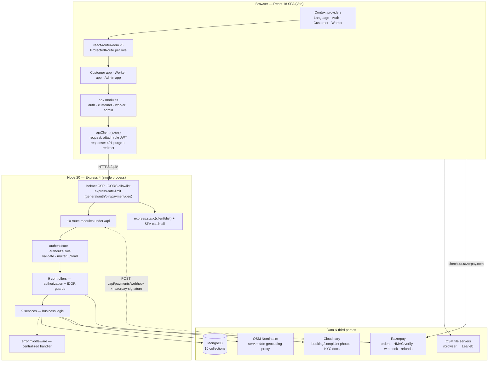
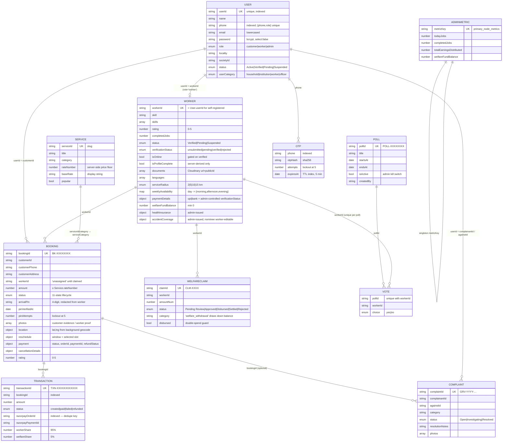
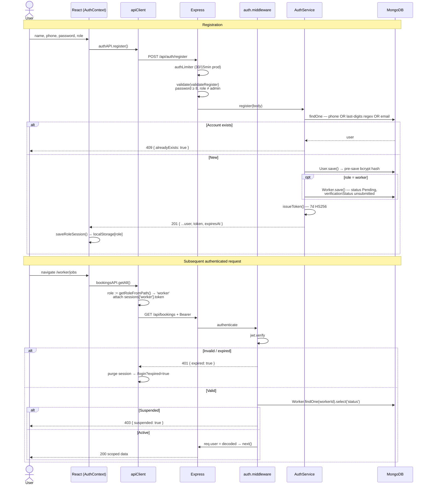
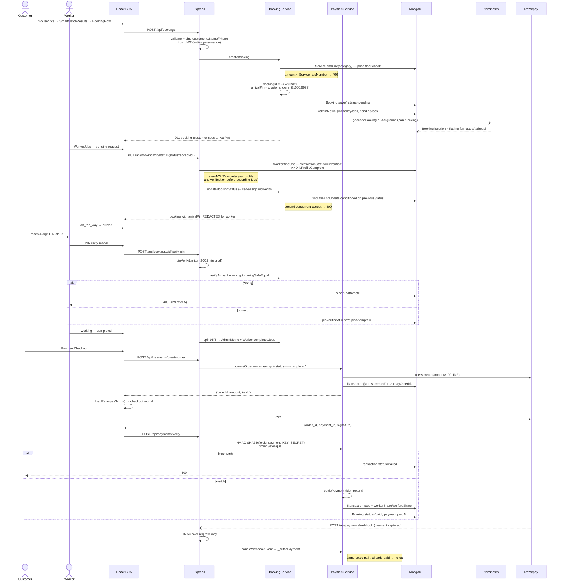
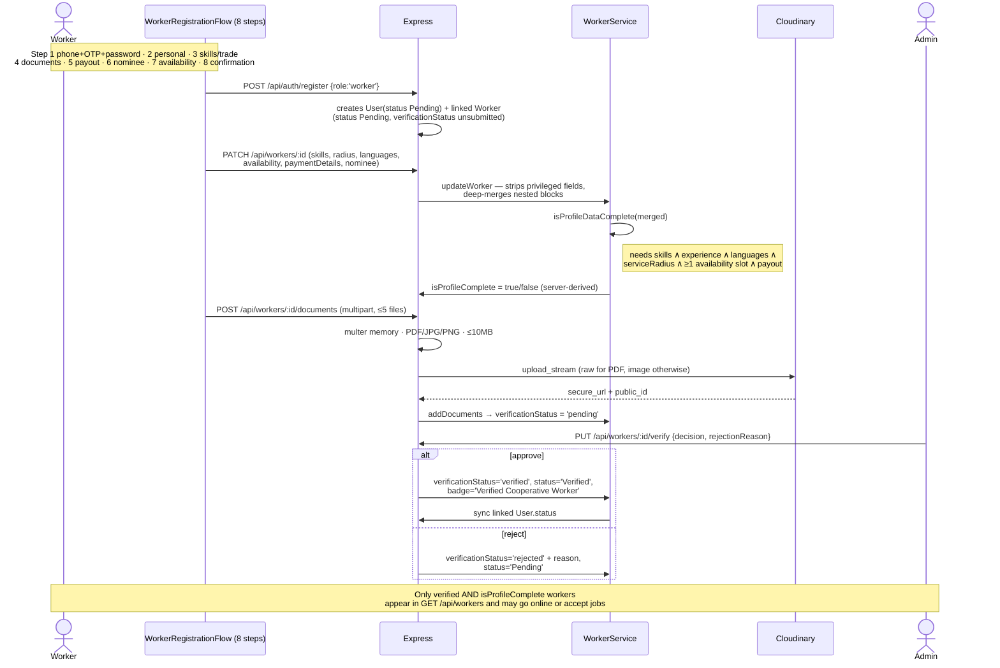
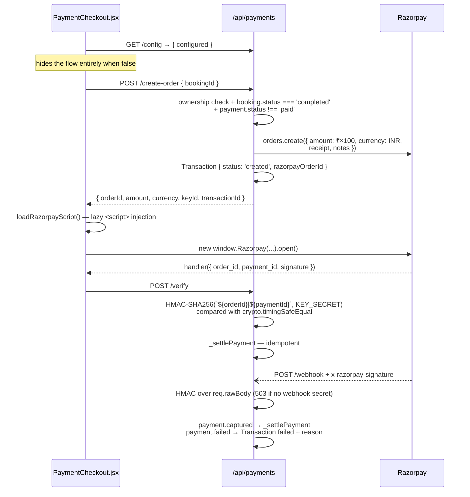

# WorkHive — Cooperative Labour & Service Platform

> A full-stack MERN platform that connects informal trade workers (electricians, plumbers, carpenters, cleaners, caregivers) with households and institutions under a **worker-cooperative model**: 95% of every job fee goes to the worker, 5% is escrowed into a welfare fund, and the platform takes no cut.

[](https://react.dev/)
[](https://nodejs.org/)
[](https://www.mongodb.com/)
[](https://razorpay.com/)
[](Dockerfile)
[](server/tests)
[](LICENSE)

---

## Table of Contents

1. [What This Project Actually Is](#1-what-this-project-actually-is)
2. [System Architecture](#2-system-architecture)
3. [How Everything Connects](#3-how-everything-connects)
4. [Technology Stack](#4-technology-stack)
5. [Folder Structure](#5-folder-structure)
6. [Database Architecture](#6-database-architecture)
7. [Authentication & Authorization](#7-authentication--authorization)
8. [Core Workflows (End-to-End Data Flow)](#8-core-workflows-end-to-end-data-flow)
9. [Feature Inventory](#9-feature-inventory)
10. [API Reference](#10-api-reference)
11. [Important Modules](#11-important-modules)
12. [External Integrations](#12-external-integrations)
13. [Frontend Architecture](#13-frontend-architecture)
14. [Error Handling & Validation](#14-error-handling--validation)
15. [Security](#15-security)
16. [Testing](#16-testing)
17. [Configuration & Environment Variables](#17-configuration--environment-variables)
18. [Installation & Setup](#18-installation--setup)
19. [Scripts](#19-scripts)
20. [Deployment](#20-deployment)
21. [Developer Guide](#21-developer-guide)
22. [Known Gaps & Recommended Improvements](#22-known-gaps--recommended-improvements)

---

## 1. What This Project Actually Is

WorkHive is a **single-repository, three-app MERN platform** built around one Express API and one MongoDB database. The three apps are not separate deployments — they are three route trees inside one React SPA, gated by role:

| App | Route prefix | Who uses it | What it does |
|---|---|---|---|
| **Customer** | `/customer/*` | Households, institutions | Browse the service catalogue, search & match workers, book jobs, track a worker on a live map, verify arrival by PIN, pay via Razorpay, rate, file grievances |
| **Worker** | `/worker/*` | Cooperative member workers | 8-step onboarding, upload KYC documents, set skills/radius/availability/payout, accept or reject or reschedule broadcast jobs, verify arrival PIN, track earnings, view welfare & insurance, vote on cooperative resolutions |
| **Admin** | `/admin/*` | Cooperative officers | Approve/reject worker verification, suspend accounts, manage the service catalogue, view all bookings, resolve grievances, issue insurance, approve welfare claims, run polls, view live telemetry |

**The problem it solves.** Informal-sector service workers in India typically lose 20–30% of every job to an aggregator platform, have no verification credential they own, no welfare safety net, and no say in platform policy. WorkHive models the alternative: a registered cooperative society where the worker keeps 95%, 5% accrues to a per-worker welfare escrow, verification is a documented admin pipeline, and policy changes are decided by one-worker-one-vote polls enforced at the database level.

### Honest scope notes (verified against the code)

These are stated up front because the README's job is to describe what exists:

- **There is no AI/ML anywhere in this project.** "Smart Match" is a deterministic trade-keyword matcher plus a rating sort (`SmartMatchResults.jsx`). "Demand Forecast" is a heuristic over the live `Service`/`Booking`/`Worker` collections (`DemandForecast.jsx`). No model, no inference service, no LLM call.
- **There is no SMS provider.** `POST /api/auth/send-otp` hashes and stores a real OTP with a TTL, but delivery is a `console.log` when `NODE_ENV !== 'production'`. In production the code path exists but no gateway is wired.
- **Worker GPS is simulated.** `TrackingMap.jsx` geocodes the *customer's real address* via Nominatim and renders a real OpenStreetMap tile map with a real pin — but the moving worker marker interpolates from a deterministic pseudo-depot offset. There is no device-location ingestion endpoint.
- **Several worker "stats" are static schema defaults**, not computed: `matchScore`, `distance`, `availability`, `priceEstimate`, `onTimeRate`, and `breakdown.*` on the `Worker` model are display strings with defaults; only `rating`, `completedJobs`, and `welfareFundBalance` are actually mutated by application logic.
- **The CI workflow is disabled** — `.github/workflows/ci.yml` runs on `workflow_dispatch` only.

---

## 2. System Architecture

### 2.1 Architectural pattern

The backend is a **layered monolith** with strict, one-directional dependencies:

```
Route  →  Validator middleware  →  Controller  →  Service  →  Mongoose Model  →  MongoDB
```

Each layer has one job, and the split is enforced consistently across all nine domains (auth, worker, service, booking, complaint, cooperative, poll, admin, payment):

| Layer | Directory | Responsibility | Never does |
|---|---|---|---|
| **Route** | `server/routes/` | URL → handler binding; attaches `authenticate`, `authorizeRole`, per-route rate limiters, multer upload middleware | Business logic |
| **Validator** | `server/validators/` | Pure shape/format checks on `req`; returns `{isValid, message}` | DB access |
| **Controller** | `server/controllers/` | **Authorization decisions** (ownership/IDOR checks), request-body sanitisation (stripping privileged fields), response shaping, file→Cloudinary upload | Query models directly (mostly) |
| **Service** | `server/services/` | All business logic: state machines, money splits, tallies, concurrency guards | Touch `req`/`res` |
| **Model** | `server/models/` | Schema, indexes, hooks (bcrypt pre-save), instance methods | Contain workflow logic |

The frontend mirrors this:

```
Page component  →  Domain API module  →  apiClient (axios + interceptors)  →  HTTP
```

The **production topology is a single Node process**: `server.js` detects `client/dist/` and serves the built SPA plus the API from the same origin, with a catch-all that returns `index.html` for client-side routing. That is why CORS is optional in a unified deployment and mandatory in a split (Vercel frontend + Render backend) one.

### 2.2 System diagram



### 2.3 Why the layering matters here

Two design decisions are worth calling out because they shape the whole codebase:

**Authorization lives in controllers, business rules live in services.** `booking.controller.js` decides *whether you may touch this booking* (are you the owner? the assigned worker? an admin? is this job unclaimed and therefore open to any verified worker?). `booking.service.js` decides *whether this transition is legal at all* (is `pending → completed` allowed? has the arrival PIN been verified?). A request must pass both. This is why an admin's `forceAdminOverride` is set in the controller (`isAdmin && Boolean(req.body.forceAdminOverride)`) and consumed in the service — the flag can never be self-granted from a request body.

**Privileged fields are stripped, not validated.** `worker.controller.js#updateWorker` deletes `status`, `badge`, `rating`, `completedJobs`, `societyReg`, `verificationStatus`, `rejectionReason`, `documents`, `welfareFundBalance`, `healthInsurance`, `paymentDetails.verificationStatus`, and all of `accidentCoverage` except `nominee` from any non-admin body — and deletes `isProfileComplete` from *every* body, admin included, because it is always derived server-side. The service then recomputes it. There is a test for each of these guards.

---

## 3. How Everything Connects

```
                                   ┌──────────────┐
                                   │     User     │
                                   └──────┬───────┘
                                          │  loads SPA
                                          ▼
    ┌──────────────────────────────────────────────────────────────────┐
    │  React SPA                                                       │
    │  AuthContext  ── role-keyed sessions in localStorage             │
    │      │          workhive_role_sessions = { customer|worker|admin}│
    │      ▼                                                           │
    │  ProtectedRoute(requiredRole) ── validates 7-day expiry          │
    │      │                                                           │
    │      ▼                                                           │
    │  <Role>Shell (nav chrome) → Page component                       │
    │      │                                                           │
    │      ▼                                                           │
    │  api/*.api.js  → apiClient                                       │
    │      │  request interceptor: picks the JWT for the role implied  │
    │      │  by window.location.pathname (NOT the global active role) │
    └──────┼───────────────────────────────────────────────────────────┘
           │  Authorization: Bearer <jwt>
           ▼
    ┌──────────────────────────────────────────────────────────────────┐
    │  Express                                                         │
    │  helmet CSP → CORS allowlist → rate limiter → express.json       │
    │      │                          (verify hook stashes req.rawBody)│
    │      ▼                                                           │
    │  authenticate  ── jwt.verify + LIVE account-status re-check      │
    │      │              (a suspension takes effect on the next       │
    │      │               request, not in 7 days)                     │
    │      ▼                                                           │
    │  authorizeRole('admin' | 'worker' | ...)                         │
    │      ▼                                                           │
    │  validate(validatorFn)  ── shape checks → ApiError(400)          │
    │      ▼                                                           │
    │  Controller  ── ownership / IDOR / field-stripping               │
    │      ▼                                                           │
    │  Service  ── state machine, money split, tallies, concurrency    │
    │      ▼                                                           │
    │  Mongoose Model  ── schema validation, indexes, bcrypt hook      │
    │      ▼                                                           │
    │  MongoDB                                                         │
    │      │                                                           │
    │      └─► response → ApiResponse.success / errorHandler           │
    └──────┼───────────────────────────────────────────────────────────┘
           │  { success, message, data }
           ▼
    Frontend state update → re-render
```

**In words.** The browser holds up to three simultaneous sessions — one per role — in `localStorage` under `workhive_role_sessions`. The axios request interceptor deliberately derives the role from the *current URL path* rather than a global "active role" flag, because that flag is shared across browser tabs; with an admin panel open in one tab and a worker screen in another, a global flag would attach the wrong account's token to the wrong tab's request. Every authenticated request is verified twice on the server: the JWT signature proves who you claim to be, and a live `User`/`Worker` lookup proves your account is not suspended right now. Only then does the controller ask whether you own the resource, and the service whether the operation is legal.

---

## 4. Technology Stack

Everything below is listed because it is **actually used in application code**, with a note on where.

### Frontend

| Technology | Version | How it is used |
|---|---|---|
| **React** | 18.3 | Function components + hooks throughout; `StrictMode` in `main.jsx` |
| **Vite** | 5.4 | Dev server on `:5173` with `/api` proxy to `:5000`; production build with manual vendor chunks (`vendor-react`, `vendor-icons`, `vendor-network`) |
| **react-router-dom** | 6.26 | `BrowserRouter`, five route modules composed in `routes/index.jsx`, `ProtectedRoute` guard, v7 future flags enabled |
| **axios** | 1.20 | Single `apiClient` instance with request (JWT attach) and response (401 purge + network toast) interceptors; 10s timeout |
| **react-leaflet + leaflet** | 4.2 / 1.9 | `TrackingMap.jsx` and `AdminMapScreen.jsx` — real OSM tiles, `L.divIcon` emoji markers, `Polyline` route |
| **lucide-react** | 1.16 | Icon set across every screen |
| **CSS custom properties** | — | `styles/theme.css` (design tokens: colours, type scale, spacing, radii) + `styles/components.css`. **No Tailwind, no CSS-in-JS library** — component styling is inline `style={{}}` objects reading CSS variables |
| **React Context** | — | State management. Four providers: `LanguageContext`, `AuthContext`, `CustomerContext`, `WorkerContext`. No Redux/Zustand/React Query |
| **JSON i18n** | — | `i18n/translations.json` with `en`, `ta`, `hi`, `te`, `mr`; `t(key, fallback)` with English fallback |

### Backend

| Technology | Version | How it is used |
|---|---|---|
| **Node.js** | ≥18 (`.nvmrc` pins 20) | Runtime |
| **Express** | 4.19 | HTTP framework; 10 mounted routers under `/api` |
| **Mongoose** | 9.9 | ODM — 10 schemas, compound & TTL indexes, pre-save hooks, `$facet` aggregations |
| **jsonwebtoken** | 9.0 | HS256 tokens, 7-day expiry, signed in `AuthService.issueToken` |
| **bcryptjs** | 3.0 | Password hashing, salt rounds 10, in the `User` pre-save hook |
| **helmet** | 8.3 | Security headers with an explicit CSP allowing Razorpay, Cloudinary, OSM tiles, Google Fonts |
| **cors** | 2.8 | Function-based origin allowlist (locals + `CORS_ORIGIN` + platform-injected URLs) |
| **express-rate-limit** | 8.7 | Five distinct limiters: general `/api`, auth endpoints, PIN verification, payments, geocoding |
| **multer** | 2.0 | `memoryStorage` only — files stream to Cloudinary and never touch disk. Two configs: single 8MB image (photos), up to 5×10MB PDF/JPG/PNG (KYC docs) |
| **cloudinary** | 2.5 | `upload_stream` from the multer buffer; image transform `1600×1600 limit, quality:auto` |
| **razorpay** | 2.9 | Order creation and refunds; HMAC verification is done with Node's own `crypto` |
| **dotenv** | 17.4 | Loads `server/.env` |
| **mongodb-memory-server** | 11.2 | Dev/test fallback DB and test harness (a `devDependency`, gated behind `ALLOW_IN_MEMORY_DB`) |

### Database

- **MongoDB** (Atlas or local), accessed through Mongoose.
- Connection is in `server/db/connection.js`, with a deliberate **fail-loud policy**: in production a missing `MONGODB_URI` throws before the server listens, and the in-memory fallback is refused outright so data loss can never be silent.
- 10 collections; relationships are modelled by **string business keys** (`userId`, `workerId`, `bookingId`, `pollId`, `claimId`, `complaintId`, `serviceId`, `transactionId`), not `ObjectId` refs — so there is no `.populate()` anywhere. Most read paths accept *either* the business key or a 24-hex `_id`.

### DevOps / Deployment

| Concern | Implementation |
|---|---|
| **Container** | Multi-stage `Dockerfile`: `node:20-alpine` client build → `node:20-alpine` runner with `--omit=dev` server deps, `USER node`, `HEALTHCHECK` on `/api/health` |
| **Local orchestration** | `docker-compose.yml` — app + `mongo:7-jammy` with a healthcheck gate, named volume, Mongo bound to `127.0.0.1` only, and required-variable syntax (`${JWT_SECRET:?...}`) so it refuses to start with defaults |
| **PaaS** | `render.yaml` (web service, `healthCheckPath: /api/health`, `JWT_SECRET` auto-generated), `Procfile` (`web: npm start`), `vercel.json` (frontend-only build → `client/dist` with SPA rewrites), `client/public/_redirects` (Netlify) |
| **CI** | `.github/workflows/ci.yml` — installs both packages, runs server tests against an in-memory Mongo, builds the client. **Currently `workflow_dispatch` only** |

### External services

| Service | Purpose | Auth | Degradation when unconfigured |
|---|---|---|---|
| **Razorpay** | Payment orders, signature verification, webhooks, refunds | `RAZORPAY_KEY_ID` / `_SECRET`; webhook via `RAZORPAY_WEBHOOK_SECRET` | `503` from `/create-order`; `/payments/config` reports `configured: false` so the UI can hide the flow; refunds fall back to `refundStatus: 'pending'` for manual settlement |
| **Cloudinary** | Booking photos, complaint evidence, worker KYC documents | Cloud name + key + secret | Upload endpoints return `503` with an explicit message; everything else works |
| **OSM Nominatim** | Address → coordinates | None (requires an identifying `User-Agent`, kept server-side) | `geocodeAddress` returns `null`, never throws; the map falls back to a fixed Chennai centre |
| **OSM tile servers** | Map tiles | None | Browser-side; allowlisted in the CSP `imgSrc` |

---

## 5. Folder Structure

```
Labour-Cooperative-Platform/
│
├── client/                                   # React 18 + Vite SPA
│   ├── src/
│   │   ├── api/                              # ── The ONLY place HTTP is spoken
│   │   │   ├── apiClient.js                  #    axios instance + both interceptors
│   │   │   ├── auth.api.js                   #    login/register/otp/profile
│   │   │   ├── customer.api.js               #    servicesAPI, bookingsAPI, paymentsAPI, geoAPI
│   │   │   ├── worker.api.js                 #    workersAPI, cooperativeAPI, pollsAPI
│   │   │   ├── admin.api.js                  #    adminAPI, complaintsAPI, healthAPI
│   │   │   └── index.js                      #    barrel re-export
│   │   │
│   │   ├── apps/                             # ── Three role apps, one bundle
│   │   │   ├── customer/
│   │   │   │   ├── CustomerShell.jsx         #    TopBar + BottomTabBar chrome
│   │   │   │   ├── context/CustomerContext.jsx
│   │   │   │   ├── components/               #    TrackingMap, CancelBookingModal
│   │   │   │   └── pages/                    #    13 pages: Home, ServiceSearch,
│   │   │   │                                 #    SmartMatchResults, BookingFlow,
│   │   │   │                                 #    BookingTracking, PaymentCheckout,
│   │   │   │                                 #    RatingFeedback, EmergencyService, …
│   │   │   ├── worker/
│   │   │   │   ├── WorkerShell.jsx           #    Sidebar/BottomTabBar + profile-completion gate
│   │   │   │   ├── context/WorkerContext.jsx #    Syncs the live Worker record from the DB
│   │   │   │   └── pages/
│   │   │   │       ├── registration/WorkerRegistrationFlow.jsx   # 8-step onboarding wizard
│   │   │   │       └── …                     #    Dashboard, Jobs, JobRequest, JobManagement,
│   │   │   │                                 #    Earnings, Welfare, SkillProfile,
│   │   │   │                                 #    VerificationStatus, CooperativeVoting
│   │   │   └── admin/
│   │   │       ├── AdminShell.jsx            #    Sidebar with live count badges
│   │   │       └── pages/                    #    Dashboard, WorkerManagement, AdminCustomers,
│   │   │                                     #    AllBookings, AdminServicesScreen,
│   │   │                                     #    ComplaintsScreen, DemandForecast,
│   │   │                                     #    AdminMapScreen, CooperativeEconomics, Settings
│   │   │
│   │   ├── components/                       # ── Shared design-system primitives
│   │   │   ├── Button/Card/Badge/StarRating/EmptyState/LoadingState
│   │   │   ├── TopBar / Sidebar / BottomTabBar / LanguageSwitcher
│   │   │   ├── ErrorBoundary.jsx             #    Wraps the whole app in App.jsx
│   │   │   └── WorkerPublicProfile.jsx       #    Reused by customer view AND worker preview
│   │   │
│   │   ├── context/
│   │   │   ├── AuthContext.jsx               #    Role-keyed sessions, 7-day expiry, 30s sweeper
│   │   │   └── LanguageContext.jsx           #    5-language t() with English fallback
│   │   │
│   │   ├── routes/                           # ── Route tree, one module per role
│   │   │   ├── index.jsx  PublicRoutes  AuthRoutes
│   │   │   ├── CustomerRoutes  WorkerRoutes  AdminRoutes
│   │   │   └── ProtectedRoute.jsx            #    Session validity + role sync guard
│   │   │
│   │   ├── styles/theme.css                  #    Design tokens (the single source of visual truth)
│   │   ├── styles/components.css
│   │   ├── i18n/translations.json            #    en / ta / hi / te / mr
│   │   ├── utils/loadRazorpay.js             #    Lazy checkout.js injection
│   │   ├── App.jsx                           #    Provider composition root
│   │   └── main.jsx                          #    ReactDOM root + bfcache reload fix
│   ├── public/_redirects                     #    Netlify SPA fallback
│   ├── vite.config.js                        #    Dev proxy + manual chunks
│   └── vercel.json
│
├── server/                                   # Express API
│   ├── server.js                             # ── ENTRY POINT: middleware chain, route mounting,
│   │                                         #    /api/health, SPA static serving, graceful shutdown
│   ├── config/
│   │   ├── cloudinary.js                     #    Configures SDK only if all 3 vars present;
│   │   │                                     #    exports isCloudinaryConfigured
│   │   └── constants.js                      #    DEFAULT_LOCALITY / DEFAULT_SOCIETY_ID
│   ├── db/
│   │   ├── connection.js                     #    connectDB with fail-loud production policy
│   │   └── seed.js                           #    8-service catalogue, default poll, admin bootstrap
│   ├── middleware/
│   │   ├── auth.middleware.js                #    authenticate / authorizeRole / optionalAuth
│   │   ├── error.middleware.js               #    Centralized error → JSON translator
│   │   ├── validate.middleware.js            #    Runs a validator fn, throws ApiError(400)
│   │   ├── upload.middleware.js              #    multer: 1 image ≤8MB
│   │   └── verificationUpload.middleware.js  #    multer: ≤5 PDF/JPG/PNG ≤10MB each
│   ├── models/                               #    10 Mongoose schemas (see §6)
│   ├── routes/                               #    10 routers — guards + limiters live here
│   ├── controllers/                          #    9 controllers — authorization + IDOR
│   ├── services/                             #    9 services — all business logic
│   ├── validators/                           #    7 pure validator modules
│   ├── utils/
│   │   ├── apiError.js  apiResponse.js  asyncHandler.js
│   │   ├── cloudinaryUpload.js  escapeRegex.js  geocode.js
│   ├── scripts/                              #    Manual audit/smoke scripts (not part of `npm test`)
│   │   ├── smokeTestNewFeatures.js  testMasterAudit.js  testRouteAudit.js
│   └── tests/                                #    6 Jest + Supertest suites, 67 tests
│
├── docs/                                     # Supplementary docs (api, architecture, database,
│                                             # deployment, setup) — see §22 for accuracy caveats
├── Dockerfile  docker-compose.yml
├── render.yaml  vercel.json  Procfile  .nvmrc
├── .env.production.example                   # Production env template
├── DEPLOYMENT_CHECKLIST.md
├── bug_date_time.md                          # Full-stack audit report (bug log with fixes)
├── package.json                              # Workspace-level scripts
└── LICENSE                                   # ISC
```

### Why the important directories exist

- **`client/src/api/`** — the single boundary between React and HTTP. No component calls `axios` directly, so the JWT attach/expiry logic exists in exactly one place. Change auth transport here and the whole app follows.
- **`client/src/apps/<role>/`** — role isolation without three deployments. Each role owns a Shell (nav chrome + role-specific gating), an optional Context (role-scoped server state), and pages. Nothing in `apps/customer` imports from `apps/worker`.
- **`client/src/routes/`** — route definitions are *arrays of `<Route>` elements* composed in `index.jsx`, which is what lets each role module also declare its own aliases (case variants, plural forms, common typos) without bloating a single file.
- **`server/services/`** — the layer you should read first to understand the product. Every rule that matters (booking state machine, 95/5 split, vote idempotency, welfare double-spend prevention, profile completeness) lives here, not in controllers.
- **`server/validators/`** — deliberately dependency-free pure functions returning `{isValid, message}`. They are trivially unit-testable and are invoked through one generic `validate()` middleware.
- **`server/utils/apiError.js` + `error.middleware.js`** — together they make every failure path a single `throw`. `asyncHandler` catches it, the error middleware translates it (including Mongoose `CastError`, `E11000`, `ValidationError`, and JWT errors) into a consistent JSON body.

---

## 6. Database Architecture

### 6.1 Connection & lifecycle

`server/db/connection.js`:

1. Production **requires** `MONGODB_URI` — a missing value throws before `app.listen`.
2. Development defaults to `mongodb://127.0.0.1:27017/workhive`.
3. `serverSelectionTimeoutMS: 5000`.
4. On failure: if production, or if `ALLOW_IN_MEMORY_DB !== 'true'` (and not `NODE_ENV=test`), **rethrow and die**. Otherwise spin up `mongodb-memory-server` with a loud warning that data will not persist.
5. Credentials are masked in the connection log.
6. `SIGTERM`/`SIGINT` trigger `gracefulShutdown` — close the HTTP server, then close the Mongoose connection.

On every boot `server.js` runs `seedDatabase()` (inserts the 8-service catalogue and a default poll only if those collections are empty — **no fake users or workers are ever created**) and `ensureAdminUser()` (creates the single admin from `ADMIN_EMAIL`/`ADMIN_PASSWORD` if no admin exists; silently skipped when unset).

### 6.2 Entity relationship diagram

Relationships are by string business key, so this diagram shows logical references, not `ObjectId` joins.



### 6.3 Indexes and why each exists

| Collection | Index | Purpose |
|---|---|---|
| `users` | `userId` unique | Primary business key lookup on every authenticated request |
| `users` | `{phone: 1, role: 1}` unique | **One account per phone per role** — this is what allows the same person to hold both a customer and a worker account |
| `users` | `role` | Admin customer/worker directory counts |
| `workers` | `workerId` unique | Business key |
| `workers` | `{status, isOnline}` | "Active workers" telemetry |
| `workers` | `verificationStatus` | Admin verification queue |
| `workers` | `skill` | Directory filtering |
| `workers` | `{rating: -1, completedJobs: -1}` | Default directory sort order |
| `bookings` | `bookingId` unique | Business key |
| `bookings` | `{workerId, createdAt: -1}` | Worker job feed |
| `bookings` | `{customerPhone, createdAt: -1}` / `{customerId, createdAt: -1}` | Customer booking history |
| `bookings` | `status` | Admin filtering and `$facet` aggregation |
| `votes` | **`{pollId, workerId}` unique** | The one-worker-one-vote guarantee, enforced by MongoDB rather than by a race-prone read-then-write |
| `otps` | `expiresAt` TTL (`expireAfterSeconds: 0`) | MongoDB auto-deletes expired OTPs; no cleanup job needed |
| `polls` | `{isActive, startsAt, endsAt}` | Active-poll listing |
| `transactions` | `razorpayOrderId` | Webhook de-duplication |

### 6.4 Notable data-integrity mechanisms

- **Passwords** are `select: false` at schema level, hashed in a `pre('save')` hook, and deleted again in a `toJSON` transform — three independent layers so a hash cannot leak through a forgotten `.select()`.
- **`Vote` uniqueness** is a DB constraint. `PollService.castVote` catches `E11000` and returns `409` — no check-then-insert window.
- **`WelfareClaim.disbursed`** is a boolean latch. A `welfare_withdrawal` claim debits `Worker.welfareFundBalance` exactly once, no matter how many times an admin moves it between `Approved → Disbursed → Settled`. There is a test asserting this.
- **`Worker.welfareFundBalance`** has `min: 0`, and `adjustWelfareBalance` refuses any delta that would go negative.
- **Vote tallies are never stored.** `poll.service.js` recomputes them from the `Vote` collection with an aggregation on every read, so a denormalised counter can never drift.
- **Booking concurrency** — `updateBookingStatus` conditions its `findOneAndUpdate` on the status it just read, so two workers accepting the same unassigned job produce one success and one `409`, never a silent overwrite.

---

## 7. Authentication & Authorization

### 7.1 Credential handling

| Concern | Implementation | File |
|---|---|---|
| Hashing | `bcryptjs`, `genSalt(10)`, in a `pre('save')` hook that skips when the password field is unmodified | `models/User.js` |
| Comparison | `user.comparePassword()` instance method → `bcrypt.compare` | `models/User.js` |
| Minimum length | 8 characters, enforced at registration | `validators/auth.validator.js` |
| Token | `jwt.sign({userId, role, name, phone, email}, JWT_SECRET, {expiresIn: '7d'})` — HS256 | `services/auth.service.js` |
| Transport | `Authorization: Bearer <token>` (also accepts a bare token and `x-auth-token`) | `middleware/auth.middleware.js` |
| Storage | Browser `localStorage`, keyed by role | `context/AuthContext.jsx` |
| Logout | Client-side only — the role's session entry is deleted. **There is no server-side token revocation list** | `context/AuthContext.jsx` |
| Refresh tokens | **Not implemented.** On expiry the user re-authenticates | — |

### 7.2 The three middleware

```js
authenticate       // requires a valid JWT AND a non-suspended account
authorizeRole(...) // requires req.user.role ∈ allowedRoles
optionalAuth       // attaches req.user if a valid token exists, else continues anonymously
```

`authenticate` does something most JWT implementations skip: after verifying the signature it performs a **live database lookup of the account's current status** (`Worker.status` for workers, `User.status` otherwise). If the account is `Suspended` it returns `403 { suspended: true }` immediately. This is why a complaint escalation that suspends a worker takes effect on that worker's *next request*, rather than whenever their 7-day token happens to expire. If the status lookup itself fails, the request gets `503` — it fails closed.

Expired tokens return `401 { expired: true }`, which the frontend's response interceptor uses to purge the stale session and redirect to `/login?role=…&expired=true`.

### 7.3 Roles and privilege boundaries

| Role | Created by | Can |
|---|---|---|
| `customer` | Public registration | Book, track, pay, rate, cancel own bookings, file complaints, view own transactions |
| `worker` | Public registration (creates a linked `User` **and** `Worker` record in one transaction-like flow) | Accept/reject/reschedule jobs, verify arrival PINs, upload KYC docs, edit own profile & payout & nominee, submit welfare claims, vote on polls |
| `admin` | **Boot seed only** — `ensureAdminUser()` from `ADMIN_EMAIL`/`ADMIN_PASSWORD` | Everything, plus verification review, suspension, insurance issuance, welfare balance adjustment, poll creation, catalogue CRUD, complaint resolution |

`POST /api/auth/register` with `role: 'admin'` is rejected in **two places** — the validator (`400`) and the service (`403`) — and there is no other code path that ever writes `role: 'admin'`.

### 7.4 Authentication flow



### 7.5 OTP flow

`POST /api/auth/send-otp` generates a 6-digit code with `crypto.randomInt`, stores **only its SHA-256 hash** with a 5-minute TTL (MongoDB deletes it automatically), deletes any prior OTP for that phone, and — in non-production — prints it to the server console. The response never contains the code.

`POST /api/auth/verify-otp` hashes the submission, compares, increments `attempts` on failure, locks out and deletes the record at 5 attempts (`429`), deletes the record on success, then looks up the user and issues a JWT. An unregistered phone returns `404 { notRegistered: true }` so the UI can route to registration.

---

## 8. Core Workflows (End-to-End Data Flow)

### 8.1 Booking lifecycle state machine

This is the single most important business rule in the codebase. Defined in `booking.service.js#updateBookingStatus`:

```mermaid
stateDiagram-v2
    [*] --> pending: customer creates booking
    pending --> accepted: worker claims
    pending --> rejected: worker declines (reason)
    pending --> on_the_way
    pending --> cancelled
    accepted --> on_the_way
    accepted --> arrived
    accepted --> cancelled
    on_the_way --> arrived
    on_the_way --> working: requires pinVerifiedAt
    on_the_way --> in_progress: requires pinVerifiedAt
    on_the_way --> cancelled
    arrived --> working: requires pinVerifiedAt
    arrived --> in_progress: requires pinVerifiedAt
    arrived --> completed
    arrived --> cancelled
    working --> completed
    working --> cancelled
    in_progress --> completed
    in_progress --> cancelled
    completed --> paid
    completed --> rated
    paid --> rated
    rejected --> [*]
    rated --> [*]
    cancelled --> [*]
```



Three enforcement layers stack on top of this map:

1. **Transition legality** — any edge not in the table is a `400`, unless an authenticated admin sets `forceAdminOverride`.
2. **PIN gate** — `working` and `in_progress` are unreachable unless `pinVerifiedAt` is set. A worker physically cannot start billable work without the customer reading them the code.
3. **Role gate** (in the controller) — customers may only move a booking to `cancelled`/`paid`/`rated` (and only cancel while `pending` on this route); workers may only move it to `accepted`/`on_the_way`/`arrived`/`working`/`in_progress`/`completed`.

On the **first** transition into `completed`, the service performs the cooperative money split atomically-ish: `workerTakeHome = round(amount × 0.95)`, `welfareFund = amount − workerTakeHome`, incrementing `AdminMetric` counters and `Worker.completedJobs` in a `Promise.all`. The `previousStatus !== 'completed' && previousStatus !== 'paid'` guard means this can never double-count.

### 8.2 Book → dispatch → arrive → pay (full sequence)



### 8.3 Worker onboarding & verification pipeline



The **verified + complete** pair is enforced in two independent places, which is worth understanding:

- **Read path** — `WorkerService.getWorkers` hardcodes `{verificationStatus: 'verified', isProfileComplete: true}` into the query and *ignores* any client-supplied status filter (it is overwritten, not merely defaulted). A rejected or half-onboarded worker is invisible in the public directory.
- **Write path** — `booking.controller.js` re-checks both conditions from the database before letting a worker self-assign to an unclaimed job, and `WorkerService.updateWorker` throws `403` on `isOnline: true` for an unverified worker, checked against the *merged* post-update state so it cannot be raced by sending `isOnline` and `verificationStatus` in one body.

### 8.4 Reschedule negotiation

A distinctive two-sided flow:

1. Worker proposes an **availability window** (`PUT /bookings/:id/reschedule`) — must start in the future, be ≥2 hours long (one slot), and the booking must still be `pending` or `accepted`.
2. Customer responds (`PUT /bookings/:id/reschedule/respond`) with either:
   - `accept` + `selectedStart` — the slot (`selectedStart` + 2h) must fall **entirely** inside the proposed window; the booking moves to `accepted` with `scheduledFor` set; or
   - `cancel` — the booking moves to `cancelled` and `reschedule.status` to `rejected`.

Only the assigned (or, for an unclaimed job, any) worker may propose; only the booking's own customer may respond.

### 8.5 Customer cancellation & refund

`PATCH /bookings/:id/cancel` requires a non-empty reason, verifies ownership by `customerId` **or** normalised phone, and refuses terminal states. Before flipping the status it calls `PaymentService.refundForCancelledBooking`:

- Not paid → `refundStatus: 'none'`.
- Paid, gateway configured, captured payment found → real `razorpayClient.payments.refund` → `refundStatus: 'refunded'`.
- Paid but gateway unconfigured, or the refund call throws → `refundStatus: 'pending'`, flagged for manual settlement by the cooperative office. **It never claims a refund it did not issue.**

Releasing the worker's slot needs no separate record: the worker's job lists derive "active jobs" by filtering out terminal statuses, so the status change alone frees them.

### 8.6 Grievance → suspension escalation

```
Customer/Worker files complaint (POST /api/complaints)
    │  complainant identity forced from JWT — never from the body
    ▼
Complaint { status: 'Open' }  (+ optional Cloudinary evidence photos)
    │
    ▼
Admin reviews (ComplaintsScreen) → PUT /api/complaints/:id
    │  { status: 'Investigating' | 'Resolved', resolutionNotes, escalateSuspension }
    ▼
If escalateSuspension:
    Worker.status = 'Suspended', isOnline = false, badge = 'Account Suspended'
    User.status   = 'Suspended'   ← kept in sync deliberately
    ▼
That worker's very next API call hits authenticate's live status check → 403
```

Complaint visibility is role-scoped in the service: admins see everything; everyone else sees only complaints where they are the complainant **or** the respondent (matched by id or exact-name regex, with the input regex-escaped).

### 8.7 Democratic voting

```
Admin: POST /api/polls { title, description, startsAt, endsAt, isActive }
   ↓
Worker: GET /api/polls          → active, in-window polls only
        (admin ?all=true         → drafts, closed, and upcoming too)
   ↓  each poll carries live yesCount/noCount/totalVotes/myVote,
      always aggregated from the Vote collection — never stored on the Poll
   ↓
Worker: POST /api/polls/:id/vote { choice: 'yes' | 'no' }
   ↓  authorizeRole('worker') → poll open? (isActive ∧ now ∈ [startsAt, endsAt])
   ↓  Vote.create → unique {pollId, workerId} index
   ↓  E11000 → 409 "You have already cast your vote on this poll."
   ↓
Returns the poll with recomputed tallies
```

---

## 9. Feature Inventory

Every item below maps to code that exists.

### Authentication & session

- Registration for `customer` and `worker` (admin creation blocked at two layers), with cross-role duplicate detection by exact phone, trailing-digits regex, and email.
- Login by **phone, email, userId, or exact name**, optionally scoped by role; suspended accounts rejected for both `User` and linked `Worker`.
- SHA-256-hashed OTP login with 5-minute TTL, 5-attempt lockout, and anti-replay deletion on success.
- 7-day JWT sessions, **three simultaneously** (one per role) in the browser.
- Client-side expiry sweeper every 30 seconds; legacy `sahakari_seva_*` storage keys migrated automatically.
- `ProtectedRoute` guard with expired-session detection and post-login redirect preservation.
- Automatic session purge + redirect on any `401` to an authenticated request.

### Customer app

- Live service catalogue from MongoDB with category/keyword search.
- **Smart Match** — trade-keyword matching (exact, substring, 4-char stem, and a 10-trade keyword map covering electrician/plumber/carpenter/painter/cleaner/caregiver/gardener/driver/helper/technician), sorted by rating, with an expandable "why this match" breakdown.
- Public worker profiles (documents always excluded from the payload).
- Booking flow with server-enforced price floor and photo evidence upload.
- **Emergency booking** — same pipeline with `isEmergency: true`, filterable by admins.
- Live tracking: 3-second polling, real OSM map pinned at the geocoded address, status timeline, arrival PIN display, worker/customer photo gallery.
- Reschedule response (pick a slot, or cancel).
- Cancellation with mandatory reason and automatic refund attempt.
- Razorpay checkout with server-side signature verification.
- Payment history, rating & feedback, profile management.
- Grievance filing with evidence photos.

### Worker app

- 8-step registration wizard (phone/OTP/password → personal → skills → documents → payout → nominee → availability → confirmation).
- Server-derived profile-completion gate; `WorkerShell` redirects to the profile page until complete — but **fails open** if the profile fetch itself failed, since the real enforcement is server-side.
- KYC document upload (≤5 files, PDF/JPG/PNG, ≤10MB each) with resubmission after rejection.
- Verification status page including the admin's rejection reason.
- Job feed split into pending requests / active jobs / past jobs; accept, reject with reason, or propose a reschedule window.
- Arrival PIN entry — **the worker's own API responses have `arrivalPin` stripped out**, so the code can only come from the customer.
- Job management with photo proof of completion.
- Earnings view and 95/5 cooperative economics breakdown.
- Welfare page: fund balance, health & accident insurance policies, worker-editable nominee, payout verification badge.
- Welfare claim submission (including `welfare_withdrawal` claims that draw down the balance on approval).
- Cooperative voting with live tallies and one-vote enforcement.
- Online/offline toggle, gated on verification.

### Admin app

- Live telemetry dashboard computed with a MongoDB `$facet` aggregation plus eight parallel `countDocuments` calls.
- Worker roster across **all** states, including documents and booking-history counts.
- Customer directory with booking-history counts.
- Verification approve/reject with mandatory rejection reason.
- Suspend/reactivate — reactivation restores `Verified` only if the worker actually passed document review, otherwise `Pending`.
- Insurance issuance (health + accident) that preserves a nominee the worker already set.
- Manual welfare balance credit/debit with a negative-balance guard.
- Payout verification toggle.
- Service catalogue CRUD with slug-based upsert.
- All-bookings view with status and emergency filters.
- Grievance resolution with suspension escalation.
- Poll creation, editing, early closure, and full visibility including drafts.
- Demand forecast (heuristic over live catalogue, bookings, and roster).
- Map screen over geocoded booking locations.
- Demo reset — **disabled in production** unless `ALLOW_DEMO_RESET=true`.

### Cross-cutting

- Five-language UI (English, Tamil, Hindi, Telugu, Marathi) with English fallback.
- `ErrorBoundary` at the application root.
- Consistent `LoadingState` / `EmptyState` primitives.
- Dependency-free network-error toast raised from the axios interceptor.
- Mobile-first responsive layout: `BottomTabBar` on small screens, `Sidebar` on desktop.
- Extensive route aliasing (case variants, plurals, and common typos such as `/Cutomer/home` and `/admin/forcas`).

---

## 10. API Reference

**Base URL:** `/api` · **Auth:** `Authorization: Bearer <jwt>` · **Response envelope:** `{ success, message, data }` (list endpoints add `count`, `total`, `page`, `totalPages`).

### Authentication — `/api/auth`

| Method | Endpoint | Description | Auth |
|---|---|---|---|
| POST | `/auth/register` | Register a customer or worker | No |
| POST | `/auth/login` | Login by phone / email / userId / name | No |
| POST | `/auth/send-otp` | Generate & store a hashed OTP (5 min TTL) | No |
| POST | `/auth/verify-otp` | Verify OTP, issue JWT | No |
| GET | `/auth/me` · `/auth/profile` | Current user profile | Yes |
| PUT | `/auth/profile` | Update name / locality / skill / userCategory / avatar | Yes |

### Workers — `/api/workers`

| Method | Endpoint | Description | Auth |
|---|---|---|---|
| GET | `/workers` | Public directory — **verified + profile-complete only** (`?skill`, `?search`, `?page`, `?limit`) | No |
| GET | `/workers/welfare` | Own welfare/insurance/payout snapshot (admin may pass `?workerId`) | Yes |
| GET | `/workers/cooperative` | Cooperative economics (alias of `/cooperative/stats`) | Yes |
| GET | `/workers/:id` | Public profile by `workerId` or `_id` (documents excluded) | No |
| POST | `/workers` | Register a worker profile (rate-limited, intentionally unauthenticated for onboarding) | No |
| PUT · PATCH | `/workers/:id` | Partial profile update — identical handlers | Yes (self or admin) |
| POST | `/workers/:id/documents` | Upload KYC docs (multipart `documents`, ≤5) | Yes (self or admin) |
| PUT | `/workers/:id/verify` | Approve / reject verification | Admin |
| PUT | `/workers/:id/insurance` | Issue or update health / accident coverage | Admin |
| PUT | `/workers/:id/welfare-balance` | Manual balance adjustment | Admin |
| PUT | `/workers/:id/payment-verification` | Mark payout details verified | Admin |
| DELETE | `/workers/:id` | Remove a worker | Admin |

### Services — `/api/services`

| Method | Endpoint | Description | Auth |
|---|---|---|---|
| GET | `/services` | Catalogue (`?category`, `?search`), popular first | No |
| GET | `/services/:id` | One service by `serviceId` or `_id` | No |
| POST | `/services` | Create or upsert (slug-derived `serviceId`) | Admin |
| PUT | `/services/:id` | Update | Admin |
| DELETE | `/services/:id` | Delete | Admin |

### Bookings — `/api/bookings` *(all require authentication)*

| Method | Endpoint | Description | Who |
|---|---|---|---|
| GET | `/bookings` | Role-scoped list — customers forced to their own id/phone, workers to their own `workerId`, admins unrestricted | Any |
| GET | `/bookings/:id` | Single booking with IDOR guard | Owner / assigned worker / admin |
| POST | `/bookings` | Create; customer identity bound from JWT; price floor enforced | Customer |
| PUT | `/bookings/:id/status` · `/bookings/:id` | Advance the lifecycle | Owner / worker / admin |
| PUT | `/bookings/:id/reject` | Decline a pending request with a reason | Worker |
| PUT | `/bookings/:id/reschedule` | Propose an availability window (≥2h, future) | Worker |
| PUT | `/bookings/:id/reschedule/respond` | Accept a slot or cancel | Owning customer |
| POST | `/bookings/:id/verify-pin` | Verify the 4-digit arrival PIN (rate-limited, timing-safe, 5-attempt lockout) | Assigned worker |
| POST | `/bookings/:id/photos` | Attach a photo (multipart `photo`) | Owner / assigned worker / admin |
| PATCH | `/bookings/:id/cancel` | Cancel with a mandatory reason; triggers refund | Owning customer |
| DELETE | `/bookings/:id` | Remove | Admin, or owner while `pending` |

<details>
<summary><strong>Endpoint detail — POST /api/bookings</strong></summary>

**Auth:** required (customer). **Body:**

```json
{
  "customerAddress": "12 Kasturba Nagar, Adyar, Chennai",
  "serviceCategory": "Plumbing",
  "serviceDetails": "Kitchen sink leaking at the joint",
  "workerId": "wrk-1725100000000",
  "workerName": "R. Kumar",
  "amount": 450,
  "isEmergency": false
}
```

`customerId`, `customerName`, and `customerPhone` are **overwritten from the JWT** and cannot be spoofed.

**Validation:** `customerName`, `customerPhone`, `customerAddress`, `serviceCategory`, `amount` required; `amount` must be a positive number; `amount` must be ≥ the matching `Service.rateNumber`.

**Side effects:** generates `bookingId` (`BK-` + 8 hex) and a cryptographically random 4-digit `arrivalPin`; increments `AdminMetric.todayJobs` and `pendingJobs`; fires a **background** Nominatim geocode that later writes `location`.

**Responses:** `201` with the booking · `400` validation or underpayment · `401` no token · `403` suspended.
</details>

<details>
<summary><strong>Endpoint detail — POST /api/bookings/:id/verify-pin</strong></summary>

**Auth:** assigned worker only. **Body:** `{ "pin": "4821" }`

Rate-limited to 20 attempts / 15 min per IP in production, on top of a per-booking counter. Comparison uses `crypto.timingSafeEqual` after a length check.

**Responses:** `200` verified (or already verified — idempotent) · `400` incorrect PIN · `429` 5 attempts exhausted for this booking · `403` not the assigned worker.

The PIN is **never** returned to a worker in any booking response.
</details>

### Complaints — `/api/complaints` *(all require authentication)*

| Method | Endpoint | Description | Who |
|---|---|---|---|
| GET | `/complaints` | Role-scoped (`?status`, `?category`, `?page`, `?limit`) | Any |
| POST | `/complaints` | File a grievance; complainant taken from JWT | Any |
| POST | `/complaints/:id/photos` | Attach evidence (multipart `photo`) | Complainant / admin |
| PUT | `/complaints/:id` | Update status / notes / escalate to suspension | Admin |

### Cooperative — `/api/cooperative`

| Method | Endpoint | Description | Auth |
|---|---|---|---|
| GET | `/cooperative/stats` | Public transparency: totals, 95/5/0 split, society registration | No |
| GET | `/cooperative/claims` | Claims log — workers see their own, admins see all | Yes |
| POST | `/cooperative/claims` | Submit a welfare claim | Worker / admin |
| PUT | `/cooperative/claims/:id` | Approve / disburse / settle / reject | Admin |

### Polls — `/api/polls`

| Method | Endpoint | Description | Auth |
|---|---|---|---|
| GET | `/polls` | Active in-window polls with live tallies (`?all=true` for admins) | Yes |
| GET | `/polls/:id` | One poll with tallies and `myVote` | Yes |
| POST | `/polls` | Create | Admin |
| PATCH | `/polls/:id` | Edit / toggle `isActive` | Admin |
| POST | `/polls/:id/vote` | Cast `yes` / `no` — one per worker per poll | Worker |

### Payments — `/api/payments`

| Method | Endpoint | Description | Auth |
|---|---|---|---|
| POST | `/payments/webhook` | Razorpay server-to-server callback | **HMAC signature over the raw body** |
| GET | `/payments/config` | Reports whether the gateway is configured | No |
| POST | `/payments/create-order` | Create an order for a completed booking | Owner / admin |
| POST | `/payments/verify` | Verify the checkout signature and settle | Owner / admin |
| GET | `/payments/history` | Role-scoped transaction ledger | Yes |

### Admin — `/api/admin` *(router-level `authenticate` + `authorizeRole('admin')`)*

| Method | Endpoint | Description |
|---|---|---|
| GET | `/admin/stats` · `/admin/metrics` | Live aggregated telemetry |
| GET | `/admin/customers` | All customers + booking-history counts |
| GET | `/admin/workers` | Full roster (all states, with documents) + counts |
| PUT | `/admin/users/:id/status` | `Active` / `Suspended`, synced to the linked worker |
| POST | `/admin/reset-demo` | Wipe & re-seed (blocked in production unless `ALLOW_DEMO_RESET=true`) |

### Utility

| Method | Endpoint | Description | Auth |
|---|---|---|---|
| GET | `/api/health` | Status, uptime, RSS memory, Mongo connection state | No |
| GET | `/api/geo/geocode?address=` | Nominatim proxy, 30 req/min | No |
| GET | `/api/stats` | Legacy `AdminMetric` document | Admin |

### Error semantics

| Status | Meaning | Extra fields |
|---|---|---|
| `400` | Validation failure, illegal state transition, bad signature | — |
| `401` | Missing / malformed / invalid / expired token | `expired: true` when expired |
| `403` | Wrong role, not the owner, suspended, unverified worker | `suspended: true` when suspended |
| `404` | Resource not found | `notRegistered: true` on OTP for an unknown phone |
| `409` | Duplicate account, duplicate vote, concurrent-update conflict | `alreadyExists: true` |
| `429` | Rate limit or attempt lockout | — |
| `503` | Cloudinary/Razorpay unconfigured, or account-status check failed | — |

---

## 11. Important Modules

### BookingService — `server/services/booking.service.js` (559 lines)

**Purpose.** Owns the entire job lifecycle: creation with price validation, the transition state machine, PIN verification, reschedule negotiation, rejection, cancellation with refund, photo attachment, and the cooperative money split.

**Flow.** Every mutating method resolves the booking by `bookingId` *or* `_id` via `_resolveBooking`, which also returns the exact match key so the follow-up update is a **conditional** `findOneAndUpdate` — the concurrency primitive used throughout.

**Dependencies.** `Booking`, `Worker`, `Service`, `AdminMetric` models; `PaymentService` (refunds); `geocode` util; `escapeRegex`.

**Worth reading for:** the `VALID_STATUS_TRANSITIONS` map, the `previousStatus`-conditioned write, and `geocodeBookingInBackground` (fire-and-forget enrichment that never blocks or fails a booking).

### WorkerService — `server/services/worker.service.js` (450 lines)

**Purpose.** Directory queries, profile updates, completeness derivation, document intake, verification review, and the admin-only insurance / welfare / payout-verification actions.

**Three functions deserve attention:**

- `isProfileDataComplete(worker)` — the single definition of "ready to work". Never accepted from a client.
- `flattenNestedUpdate(prefix, obj)` — converts `{paymentDetails: {upiId: 'x'}}` into `{'paymentDetails.upiId': 'x'}`. Without it, Mongoose would replace the *entire* embedded object, so a worker saving a UPI id would silently erase their bank details, and an admin verifying payment would erase the worker's UPI id.
- `deepMerge(base, incoming)` — computes what the record *will* look like post-update, so completeness and the online-gate are evaluated against the merged state rather than stale data.

### PaymentService — `server/services/payment.service.js` (244 lines)

**Purpose.** Razorpay order creation, signature verification, webhook handling, refunds, and the transaction ledger.

**The key design point is `_settlePayment`** — one shared settlement path used by *both* the client-verify endpoint and the server webhook. It is idempotent at three levels: an early `payment.status === 'paid'` return, a `{status: {$ne: 'paid'}}` guard on the transaction update, and the same guard on the booking update. Whichever path confirms first wins; the other becomes a no-op. This is what makes a duplicate webhook harmless.

The `Transaction` collection is deliberately **independent of `Booking`** so receipts survive booking edits and a re-run webhook can be de-duplicated by `razorpayOrderId`.

### auth.middleware.js — `server/middleware/auth.middleware.js`

**Purpose.** The gate every protected route passes through. Notable for the live status re-check described in §7.2, and for lazily `require`-ing the models inside `getAccountStatus` to avoid a require-cycle with services that import `JWT_SECRET` from this same file.

### PollService — `server/services/poll.service.js`

**Purpose.** Poll CRUD plus the tallying strategy. `attachTallies` runs one aggregation across all requested polls and one query for the caller's own votes, then merges — so listing N polls costs 2 queries, not 2N.

### apiClient.js — `client/src/api/apiClient.js`

**Purpose.** The frontend's entire HTTP policy in one file: role-correct token attachment derived from the URL path (see §3 for why), automatic session purge and login redirect on `401`, and a dependency-free toast for connectivity failures raised from outside the React tree.

### WorkerRegistrationFlow.jsx — `client/src/apps/worker/pages/registration/` (1131 lines)

**Purpose.** The 8-step onboarding wizard. Step 7 submits: it registers the account first, then best-effort `PATCH`es the full profile detail payload. If that second call fails the worker is not stranded — the account exists, and the profile-completion gate simply routes them to the Skill Profile page to finish.

---

## 12. External Integrations

### Razorpay



- **Env:** `RAZORPAY_KEY_ID`, `RAZORPAY_KEY_SECRET`, `RAZORPAY_WEBHOOK_SECRET`.
- **Raw body:** `express.json`'s `verify` hook stashes `req.rawBody`, because re-stringifying `req.body` would not reliably reproduce the exact bytes Razorpay signed.
- **Fail-closed:** no webhook secret configured → `503`, never a blind trust.
- **Fallback:** unconfigured gateway → `503` from `/create-order`; refunds degrade to `refundStatus: 'pending'`.

### Cloudinary

- **Env:** `CLOUDINARY_CLOUD_NAME`, `CLOUDINARY_API_KEY`, `CLOUDINARY_API_SECRET`. The SDK is only configured when **all three** are present; `isCloudinaryConfigured` gates every upload endpoint with a clear `503`.
- **Pipeline:** multer `memoryStorage` → `cloudinary.uploader.upload_stream` → the returned `secure_url` and `public_id` are what get persisted. **The client never supplies a URL**, so a stored document always corresponds to a real uploaded file.
- **Folders:** `workhive/bookings/<bookingId>`, `workhive/complaints/<complaintId>`, `workhive/verification/<workerId>`.
- **Transforms:** images limited to 1600×1600 with `quality: auto`; PDFs uploaded as `raw`.

### OpenStreetMap Nominatim

- No API key. Requires an identifying `User-Agent`, which is why the call is **proxied server-side** rather than made from the browser.
- In-process `Map` cache capped at 500 entries with FIFO eviction; 5-second `AbortController` timeout; returns `null` rather than throwing.
- Used at booking creation (background) and on demand via `GET /api/geo/geocode` (30 req/min), which `TrackingMap` calls only if the booking has not been geocoded yet.

---

## 13. Frontend Architecture

### Component hierarchy

```
main.jsx  (ReactDOM root, StrictMode, bfcache reload workaround)
  └── App.jsx
      └── ErrorBoundary
          └── LanguageProvider
              └── AuthProvider
                  └── CustomerProvider
                      └── WorkerProvider
                          └── BrowserRouter
                              └── AppRoutes
                                  ├── publicRoutes    → StyleGuidePage (also "/")
                                  ├── authRoutes      → AuthPortal, RegisterPortal,
                                  │                     WorkerRegistrationFlow, AdminLogin
                                  ├── customerRoutes  → ProtectedRoute → CustomerShell → page
                                  ├── workerRoutes    → ProtectedRoute → WorkerShell   → page
                                  └── adminRoutes     → ProtectedRoute → AdminShell    → page
```

### State management

There is **no state library**. State is split three ways, deliberately:

| Kind | Where | Examples |
|---|---|---|
| **Session state** | `AuthContext` + `localStorage` | Role-keyed JWT sessions, active role, expiry |
| **Role-scoped server state** | `CustomerContext`, `WorkerContext` | Customer profile + bookings; live worker record with `profileLoaded` / `profileFetchFailed` flags |
| **Page state** | `useState` in each page | Fetched lists, loading, error, form fields, modals |

`WorkerContext` is the more interesting of the two: it tracks not just the worker record but whether the record has *ever loaded* and whether the last fetch *failed*. `WorkerShell` uses both to decide whether to enforce the profile-completion redirect — it will not redirect on the default `isProfileComplete: false` before the real record arrives, and it **fails open** on a fetch error, because that gate is UX, not security.

### Routing and protection

- Route modules export **arrays of `<Route>` elements**, composed in `routes/index.jsx`. This makes per-role aliasing cheap.
- `ProtectedRoute(requiredRole)` checks a valid, unexpired session for that specific role; on failure it redirects to `/login?role=<role>&redirect=<encoded path>[&expired=true]`. When the session is valid but `activeRole` differs, it calls `switchRole` so a user holding two sessions cannot be on `/worker/*` while `currentUser` resolves to their customer identity.
- A catch-all `*` route navigates to `/`.
- Every unknown `/api/*` path returns a JSON `404`; every other unknown path serves `index.html` (SPA fallback).

### Data fetching patterns

- **Polling:** `BookingTracking` polls `GET /bookings/:id` every 3 seconds and stops on terminal statuses. There are no WebSockets or SSE anywhere.
- **Parallel fetch with partial failure:** `DemandForecast` uses `Promise.allSettled` across three endpoints so one failure does not blank the page.
- **Optimistic-ish writes:** `CustomerContext.addBooking` updates local state first, then persists.

### Styling

A token-driven system in `styles/theme.css` — three neutral grays, one warm accent (`#FF6A00`), semantic success/danger, an Inter type scale from 14px to 28px with a 16px body minimum, and spacing/radius/shadow scales. Components read tokens through inline `style` objects. `StyleGuidePage` (mounted at `/`) is the living catalogue of these primitives.

### Loading, empty, and error states

`LoadingState` and `EmptyState` are shared primitives used consistently across list screens; `ErrorBoundary` wraps the app root; network failures surface through the interceptor toast; API errors are read from `err.response?.data?.message` with a friendly rewrite for `ERR_NETWORK`.

### Responsive behaviour

Mobile-first. `BottomTabBar` on small screens (customer and worker), `Sidebar` on desktop (worker and admin), `TopBar` for the customer app. The viewport meta disables user scaling for an app-like feel.

---

## 14. Error Handling & Validation

### Backend

**Three-stage validation:**

1. **Validator middleware** — pure shape checks (`validators/*.js`) run before the controller, producing `ApiError(400)` with a specific message.
2. **Service-layer business validation** — state transitions, window durations, slot containment, claim balances, decision enums, choice enums. These throw `ApiError` with the right status.
3. **Mongoose schema validation** — enums, `required`, `min`/`max`, unique indexes.

**Centralized translation** (`error.middleware.js`) converts everything into a consistent JSON body:

| Thrown | Becomes |
|---|---|
| `ApiError(status, msg, _, extra)` | that status + `extra` merged into the body |
| Mongoose `CastError` | `400 Invalid format for resource ID: '<value>'` |
| Mongo `E11000` | `409 A record with this <field> already exists` + `alreadyExists: true` |
| Mongoose `ValidationError` | `400` with all field messages joined |
| `JsonWebTokenError` | `401 Invalid authentication token` |
| `TokenExpiredError` | `401` + `expired: true` |
| anything else | `500` (logged unless `NODE_ENV=test`) |

Stack traces are included **only** when `NODE_ENV === 'development'`. `asyncHandler` wraps every controller so no route needs a `try/catch`. `process.on('uncaughtException')` and `unhandledRejection` handlers log rather than crash.

Multer errors (wrong MIME type, oversized, too many files) are caught in a wrapper and returned as `400` JSON instead of an unhandled throw.

### Frontend

- `ErrorBoundary` at the root catches render errors.
- The axios response interceptor handles the two systemic failures: no `error.response` (offline/DNS/CORS) → toast; `401` on an authenticated request → purge session and redirect.
- Contexts normalise errors into user-facing strings (`authError`) and rewrite `Network Error` into "Cannot connect to the server…".
- Best-effort operations are explicitly non-fatal and logged with `console.warn` (background geocode, post-registration profile save, booking list refresh).

---

## 15. Security

### Implemented

| Control | Implementation |
|---|---|
| **Password hashing** | bcryptjs, 10 salt rounds, in a pre-save hook |
| **Password exposure** | `select: false` + `toJSON` transform deleting the field |
| **Token signing** | HS256, 7-day expiry; production **refuses to boot** without `JWT_SECRET` |
| **Live suspension enforcement** | Account status re-checked from the DB on every authenticated request |
| **RBAC** | `authorizeRole(...)` applied across the worker, service, poll, cooperative and complaint routers; the entire `/api/admin` router is guarded at the router level (`router.use`) |
| **IDOR / BOLA protection** | Explicit ownership checks on every booking read, update, photo upload, cancel, delete, and payment action |
| **Horizontal-leak prevention** | `getBookings` forcibly overwrites customer/worker scoping params and **deletes** a client-supplied `customerName` for scoped roles, because it would otherwise widen an `$or` |
| **Privilege-field stripping** | 12+ fields deleted from non-admin worker update bodies; `isProfileComplete` stripped from all bodies; `forceAdminOverride` recomputed as `isAdmin && …` |
| **Arrival-PIN secrecy** | `redactPinForRole` removes `arrivalPin` from every response the assigned worker can see |
| **Timing-safe comparison** | `crypto.timingSafeEqual` for arrival PINs, Razorpay checkout signatures, and webhook signatures |
| **Brute-force limits** | Per-booking PIN attempt lockout (5), OTP attempt lockout (5), plus five IP rate limiters |
| **ReDoS / regex injection** | `escapeRegex` applied to every user-supplied string interpolated into a `RegExp` |
| **Security headers** | helmet with an explicit CSP (`objectSrc: none`, `frameAncestors: none`, narrow allowlists for Razorpay / Cloudinary / OSM / Google Fonts) |
| **CORS** | Function-based allowlist; wildcard `*` is filtered out of `CORS_ORIGIN` |
| **Webhook trust** | HMAC over the **raw** body; fails closed with `503` when no secret is set |
| **Upload restrictions** | MIME allowlist, per-file size caps, file-count caps, memory storage only, server-generated URLs |
| **Payment authorization** | Order creation and verification both require booking ownership (or admin) |
| **Admin bootstrap** | Admin accounts exist only via the boot seed; registration rejects `role: 'admin'` twice |
| **Production DB safety** | No in-memory fallback; demo reset blocked unless explicitly allowed |
| **Container hardening** | Non-root `USER node`, `--omit=dev` dependencies, healthcheck, `.dockerignore` excluding `.env` |
| **Compose hardening** | Mongo bound to `127.0.0.1`; required-variable syntax refuses to start without `JWT_SECRET` / `MONGO_ROOT_PASSWORD` |
| **Proxy awareness** | `app.set('trust proxy', 1)` so rate limiting sees real client IPs behind Render |

### Recommended (NOT implemented — do not read these as existing features)

- **JWT lives in `localStorage`**, which is XSS-readable. `httpOnly` cookies plus CSRF protection would be stronger.
- **No refresh tokens and no server-side revocation.** A stolen token stays valid for its full 7 days; logout is purely client-side. A token blocklist or short access tokens + refresh rotation would close this.
- **`POST /api/workers` is unauthenticated** (rate-limited only) because onboarding calls it before a session exists. Binding it to a just-issued registration token would be tighter.
- **No account lockout on repeated failed password logins** — only IP rate limiting.
- **Password policy is length-only** (≥8), with no complexity or breach-list check.
- **No CSRF tokens** (currently mitigated by the `Authorization`-header scheme, which cookies would change).
- **No structured audit log** of admin actions (suspensions, verifications, balance adjustments).
- **No request-ID correlation or centralized log shipping.**
- **`GET /api/cooperative/stats` is fully public** — intentional transparency, but it does expose aggregate financials.
- If any secret was ever committed to git history, **rotate it** — `JWT_SECRET`, Mongo credentials, Cloudinary secret, and Razorpay keys — rather than merely removing the file. (No secrets are present in the current tree; `.env` files are correctly gitignored and only `.example` templates are tracked.)

---

## 16. Testing

**What exists:** 6 Jest + Supertest integration suites in `server/tests/`, **67 test cases** total, run with `--runInBand --detectOpenHandles --forceExit`. Each suite boots the real Express app, connects to a local MongoDB if available and otherwise falls back to `mongodb-memory-server`, and clears the relevant collections between tests.

| Suite | Tests | Covers |
|---|---|---|
| `auth.test.js` | 13 | Health & security headers, bcrypt hashing on registration, login backdoor elimination, RBAC on protected routes, OTP flow (no self-disclosure, anti-replay) |
| `worker.test.js` | 17 | Public-directory visibility guard and client-override rejection, admin approve/reject with mandatory reason, `isProfileComplete` derivation and override rejection, verified-only online toggle (including the paired-field race), admin insurance issuance preserving nominee, welfare credit/debit with negative guard, document-upload privilege escalation |
| `poll.test.js` | 13 | Admin-only creation, early closure, worker voting, **DB-enforced duplicate-vote 409**, independent votes from two workers, customer rejection, closed-poll rejection, invalid choice, active-only vs `?all=true` listing |
| `booking.test.js` | 9 | PIN generation + customer identity binding, underpayment rejection, BOLA/IDOR on view and delete, job-readiness gate on self-assignment, illegal status leaps, `forceAdminOverride` bypass prevention, full valid lifecycle |
| `admin.test.js` | 9 | Every `/api/admin/*` route rejects no-token / customer / worker, directory views with booking history, suspension syncing to the `Worker` record, invalid status value, non-admin `verificationStatus` escalation guard |
| `cooperative.test.js` | 6 | Claim submission defaults, customer rejection, worker-vs-admin claim scoping, admin approval, **withdrawal deducts exactly once across repeated status updates**, over-balance withdrawal refusal |

**Run them:**

```bash
cd server && npm test
# or, matching CI:
NODE_ENV=test JWT_SECRET=test_secret ALLOW_IN_MEMORY_DB=true npm test
```

> The suites require either a reachable MongoDB at `TEST_MONGODB_URI` (default `mongodb://127.0.0.1:27017/workhive_test`) **or** network access for `mongodb-memory-server` to download a Mongo binary on first run. In a sandbox with neither, every suite fails at setup — that is an environment issue, not a code failure.

**Also present:** three manual scripts in `server/scripts/` — `smokeTestNewFeatures.js` (end-to-end registration → booking → PIN → accept/reject → reschedule → payment against a running server), `testRouteAudit.js`, and `testMasterAudit.js`. These are **not** part of `npm test`.

**Not present:** any frontend tests. There is no Vitest, Jest-DOM, React Testing Library, Playwright, or Cypress configuration — no component, hook, or end-to-end browser test exists.

---

## 17. Configuration & Environment Variables

### Server — `server/.env` (template: `server/.env.example`)

| Variable | Purpose | Required | Default |
|---|---|---|---|
| `PORT` | HTTP listen port | No | `5000` |
| `NODE_ENV` | `development` \| `production` \| `test` | No | `development` |
| `MONGODB_URI` | MongoDB connection string | **Yes in production** (boot fails without it) | `mongodb://127.0.0.1:27017/workhive` in dev |
| `ALLOW_IN_MEMORY_DB` | Permit the in-memory fallback when the primary DB is unreachable | No | unset; **ignored in production** |
| `JWT_SECRET` | HS256 signing secret (≥32 chars) | **Yes in production** (module throws without it) | dev-only literal |
| `CORS_ORIGIN` | Comma-separated allowed origins; `*` is filtered out | No for same-origin deploys; **yes for split deploys** | locals only |
| `ADMIN_EMAIL` | Bootstrap admin email | Recommended — no admin exists without it | — |
| `ADMIN_PASSWORD` | Bootstrap admin password | Recommended | — |
| `ADMIN_NAME` | Bootstrap admin display name | No | `Administrator` |
| `ADMIN_PHONE` | Bootstrap admin phone | No | `9999999999` |
| `CLOUDINARY_CLOUD_NAME` | Cloudinary account | No — uploads return `503` without it | — |
| `CLOUDINARY_API_KEY` | Cloudinary key | No (all three needed together) | — |
| `CLOUDINARY_API_SECRET` | Cloudinary secret | No (all three needed together) | — |
| `RAZORPAY_KEY_ID` | Gateway key id | No — payments return `503` without it | — |
| `RAZORPAY_KEY_SECRET` | Gateway secret (also signs checkout HMACs) | No (both keys needed together) | — |
| `RAZORPAY_WEBHOOK_SECRET` | Webhook HMAC secret | No — the webhook returns `503` without it | — |
| `ALLOW_DEMO_RESET` | Permit `POST /api/admin/reset-demo` in production | No | unset (reset blocked) |
| `TEST_MONGODB_URI` | Test database URI | No | `mongodb://127.0.0.1:27017/workhive_test` |

Platform-injected variables also consulted for the CORS allowlist: `RENDER_EXTERNAL_URL`, `RAILWAY_STATIC_URL`, `VERCEL_URL`.

### Client — `client/.env` (template: `client/.env.example`)

| Variable | Purpose | Required | Default |
|---|---|---|---|
| `VITE_API_URL` | API base URL. Leave as `/api` for the Vite proxy (dev) or a unified deployment; set to a full URL for a split deployment | No | `/api` |

`.env.production.example` at the repository root is the deployment template for Render / Railway / Fly / Heroku / Docker.

> **Never commit real `.env` files.** They are correctly gitignored here. If a secret is ever exposed, rotate it at the provider — removing the file from a later commit does not remove it from history.

---

## 18. Installation & Setup

### Prerequisites

- **Node.js ≥ 18** (repository pins 20 via `.nvmrc`) and **npm ≥ 9**
- **MongoDB** — a local daemon or a MongoDB Atlas cluster
- *(Optional)* Cloudinary account for uploads, Razorpay test keys for payments, Docker for containerised runs

### 1. Clone

```bash
git clone https://github.com/Swarajbabu/Labour-Cooperative-Platform.git
cd Labour-Cooperative-Platform
```

### 2. Install all dependencies

```bash
npm run install:all
```

This installs the workspace root, `server/`, and `client/`.

### 3. Configure the server

```bash
cp server/.env.example server/.env
```

Then edit `server/.env`. A working minimum:

```env
PORT=5000
NODE_ENV=development
MONGODB_URI=mongodb://127.0.0.1:27017/workhive
ALLOW_IN_MEMORY_DB=true
JWT_SECRET=replace_with_a_long_random_string_at_least_32_chars
CORS_ORIGIN=http://localhost:5173
ADMIN_EMAIL=admin@workhive.coop
ADMIN_PASSWORD=ChooseAStrongAdminPassword
```

Without `ADMIN_EMAIL` / `ADMIN_PASSWORD` no admin account is created and `/admin/*` is unusable.

### 4. Configure the client (optional in dev)

```bash
cp client/.env.example client/.env    # VITE_API_URL=/api works with the Vite proxy
```

### 5. Database

No migrations and no manual seeding step. On boot the server:

- inserts the 8-service catalogue if `services` is empty,
- inserts a default cooperative poll if `polls` is empty,
- creates the admin account if none exists and the env vars are set.

**No fake users, workers, or bookings are ever seeded** — only real registrations appear.

### 6. Run — two terminals

```bash
# Terminal 1 — API on http://localhost:5000
npm run server

# Terminal 2 — Vite dev server on http://localhost:5173
npm run client
```

Open **http://localhost:5173**. The Vite proxy forwards `/api` to `:5000`.

Watch mode for the API: `cd server && npm run dev` (uses `node --watch`).

### 7. Unified production-style run

```bash
npm run build     # installs both packages and builds client/dist
npm start         # single process serving API + SPA
```

Open **http://localhost:5000** — `server.js` detects `client/dist/` and serves it.

### 8. Docker

```bash
export JWT_SECRET="$(openssl rand -hex 32)"
export MONGO_ROOT_PASSWORD="a-strong-password"
docker compose up --build
```

The compose file refuses to start without those two variables. App on `:5000`, MongoDB on `127.0.0.1:27017` with a named volume.

### 9. Tests

```bash
npm test          # from the root — delegates to the server package
# or
cd server && npm test
```

---

## 19. Scripts

### Root — `package.json`

| Script | Command | Purpose |
|---|---|---|
| `npm start` | `node server/server.js` | Production start (Procfile and Render use this) |
| `npm run server` | `node server/server.js` | API only |
| `npm run client` | `npm --prefix client run dev` | Vite dev server |
| `npm run build` | installs server + client deps, then `vite build` | Full production build |
| `npm run install:all` | installs root + server + client | One-shot setup |
| `npm test` | `npm --prefix server test` | Server test suite |

### Server — `server/package.json`

| Script | Command | Purpose |
|---|---|---|
| `npm start` | `node server.js` | Start the API |
| `npm run dev` | `node --watch server.js` | Auto-restarting dev server |
| `npm test` | `jest --runInBand --detectOpenHandles --forceExit` | Integration suites |

### Client — `client/package.json`

| Script | Command | Purpose |
|---|---|---|
| `npm run dev` | `vite` | Dev server on `:5173` with the `/api` proxy |
| `npm run build` | `vite build` | Production bundle to `client/dist` |
| `npm run preview` | `vite preview` | Serve the built bundle locally |

There is no lint script and no linter configuration in the repository.

---

## 20. Deployment

### Topology A — Unified (recommended; what `render.yaml` and the Dockerfile do)

One Node process serves the API and the built SPA from the same origin. No CORS configuration needed, no `VITE_API_URL` needed.

```
Browser ──► Render / Docker / any Node host ──► MongoDB Atlas
              ├── /api/*   → Express routers
              ├── /assets/*→ hashed chunks, cached 1 year immutable
              └── /*       → index.html (SPA fallback)
```

**Render** (`render.yaml`): build `npm run build`, start `npm start`, health check `/api/health`, `JWT_SECRET` auto-generated, all other secrets marked `sync: false` for dashboard entry.

**Docker:**

```bash
docker build -t workhive .
docker run -p 5000:5000 \
  -e MONGODB_URI="mongodb+srv://…" \
  -e JWT_SECRET="…" \
  -e ADMIN_EMAIL="…" -e ADMIN_PASSWORD="…" \
  workhive
```

The image builds the client in a first stage, installs only production server dependencies in the second, runs as the non-root `node` user, and declares a `HEALTHCHECK` against `/api/health`.

### Topology B — Split (Vercel/Netlify frontend + separate API)

```
Browser ──► Vercel (static client/dist) ──► Render/Railway (Express) ──► MongoDB Atlas
```

Required in this mode:

1. Frontend: set `VITE_API_URL=https://your-api-host/api` at build time.
2. Backend: set `CORS_ORIGIN=https://your-frontend-domain` (comma-separated for several).
3. SPA fallback is already configured — `vercel.json` rewrites `/(.*)` to `/index.html`; `client/public/_redirects` does the same for Netlify.

> Note the CORS behaviour: in production with **no** `CORS_ORIGIN` set, the server allows the requesting origin. Set `CORS_ORIGIN` explicitly for a split deployment.

### Production checklist

- [ ] `MONGODB_URI` points at a real cluster; the Atlas IP allowlist includes the host.
- [ ] `JWT_SECRET` is a fresh ≥32-char random value, not the development default.
- [ ] `ADMIN_EMAIL` / `ADMIN_PASSWORD` set — otherwise no admin account is created.
- [ ] `NODE_ENV=production` (tightens rate limits, disables the in-memory DB and stack traces).
- [ ] `ALLOW_IN_MEMORY_DB` unset; `ALLOW_DEMO_RESET` unset.
- [ ] `CORS_ORIGIN` set if the frontend is on a different domain.
- [ ] Cloudinary keys set if photo/document upload is required.
- [ ] Razorpay keys set, and the webhook URL registered in the Razorpay dashboard pointing at `POST /api/payments/webhook` with a matching `RAZORPAY_WEBHOOK_SECRET`.
- [ ] `/api/health` returns `database.connected: true`.

`DEPLOYMENT_CHECKLIST.md` in the repository root carries the project's own longer version of this list.

---

## 21. Developer Guide

### Where to start reading

Read in this order and the system will make sense in about an hour:

1. **`server/server.js`** — the whole middleware chain and every mounted route in one file.
2. **`server/models/`** — the data shapes. Start with `Booking.js` and `Worker.js`; the inline comments explain most design decisions.
3. **`server/services/booking.service.js`** — the state machine and the money split. This is the product's core.
4. **`client/src/api/apiClient.js`** — the frontend's entire HTTP policy.
5. **`client/src/routes/`** + **`client/src/App.jsx`** — how the three apps are composed and guarded.

### Entry points

| What | File |
|---|---|
| Backend process | `server/server.js` (`startServer()`) |
| Frontend bootstrap | `client/src/main.jsx` → `client/src/App.jsx` |
| Route table (API) | `server/routes/*.js`, mounted in `server.js` |
| Route table (UI) | `client/src/routes/index.jsx` |
| Auth gate (API) | `server/middleware/auth.middleware.js` |
| Auth gate (UI) | `client/src/routes/ProtectedRoute.jsx` |
| DB connection | `server/db/connection.js` |
| Seed / admin bootstrap | `server/db/seed.js` |

### Adding a new API feature

Follow the existing five-file pattern:

1. **Model** — add or extend a schema in `server/models/`, with indexes for any field you will query or sort on.
2. **Service** — put the business logic in `server/services/<domain>.service.js` as static class methods that throw `ApiError`. Never touch `req`/`res` here.
3. **Validator** — add a pure function to `server/validators/<domain>.validator.js` returning `{isValid, message}`.
4. **Controller** — add a static handler in `server/controllers/<domain>.controller.js`, wrapped in `asyncHandler`. Do the ownership/role checks and strip privileged fields here; respond via `ApiResponse`.
5. **Route** — bind it in `server/routes/<domain>Routes.js` with `authenticate`, `authorizeRole(...)`, `validate(...)`, and a rate limiter if it is abusable.
6. **Test** — add a case to the matching suite in `server/tests/`.

Then expose it to the frontend by adding a method to the relevant `client/src/api/*.api.js` module — never call axios from a component.

### Where to change what

| Goal | File(s) |
|---|---|
| Change what a role may do to a booking | `controllers/booking.controller.js` (permissions) and/or `services/booking.service.js` (`VALID_STATUS_TRANSITIONS`) |
| Change the 95/5 cooperative split | `services/booking.service.js` (completion pipeline), `services/payment.service.js` (`_settlePayment`), `services/cooperative.service.js` and `services/admin.service.js` (reported stats) — **all four**, since the ratio is repeated |
| Change what makes a worker "job-ready" | `services/worker.service.js#isProfileDataComplete` |
| Add a field a worker may edit | `controllers/worker.controller.js#updateWorker` — make sure it is *not* in the delete list |
| Add a database field | The model in `server/models/`, then the service that writes it, then any controller strip-list |
| Change the service catalogue defaults | `server/db/seed.js` (`defaultServices`) |
| Change colours, spacing, or type | `client/src/styles/theme.css` — tokens only; components read them |
| Add a UI language | `client/src/i18n/translations.json` + the `languages` array in `context/LanguageContext.jsx` |
| Add a page | Create it under `apps/<role>/pages/`, register a `<Route>` in `routes/<Role>Routes.jsx`, and add nav entries in the role's Shell |
| Change API base URL behaviour | `client/src/api/apiClient.js` |

### Conventions worth following

- Services throw `ApiError`; controllers never build error responses by hand except for authorization `403`s.
- All ids are resolvable by either the business key or a 24-hex `_id`; use `_resolveBooking`-style helpers.
- Any user string interpolated into a `RegExp` **must** pass through `escapeRegex`.
- Mutating writes that depend on the current state should use a conditional `findOneAndUpdate` rather than read-then-write.
- Derived fields (`isProfileComplete`, tallies, shares) are computed server-side and stripped from request bodies — never trusted from a client.

---

## 22. Known Gaps & Recommended Improvements

These are observations from reading the code. Nothing here is implemented — treat it as a backlog, not a feature list.

### Documentation gaps

- The `docs/` directory (`api-documentation.md`, `architecture.md`, `database-schema.md`, `deployment.md`, `development-setup.md`) predates recent work and does not describe the poll/vote system, payments, welfare balances, insurance, or the reschedule flow. It also references a `cooperativeproposals` collection that no longer exists — voting is now `Poll` + `Vote`.
- The previous README and `docs/` reference `github.com/chennaicoop/workhive`, which is not this repository's URL.
- No `CONTRIBUTING.md`, `CHANGELOG.md`, issue templates, or PR template.
- No OpenAPI/Swagger spec and no Postman collection, so API consumers must read route files.
- Environment variable documentation exists in three places (`server/.env.example`, `.env.production.example`, README) that can drift apart.

### Technical improvements

- **The 95/5 split ratio is hardcoded in four separate files.** Move it to `config/constants.js` — today, changing it means changing all four consistently.
- **`AdminMetric` is a vestigial dual source of truth.** `AdminService.getMetrics` computes everything live from aggregations, while `booking.service.js` still `$inc`s the `AdminMetric` counters (whose schema defaults are fabricated demo numbers like `totalWorkers: 1248`). Only the legacy `GET /api/stats` reads it. Either retire the collection or stop maintaining it.
- **Multi-document writes are not transactional.** Booking completion updates `AdminMetric` and `Worker` in a `Promise.all`; payment settlement updates `Transaction` then `Booking`. A crash between them leaves a partial state. MongoDB sessions/transactions (requires a replica set) would fix this.
- **Live tracking is 3-second polling.** WebSockets or SSE would cut load substantially and remove the latency floor.
- **The main client chunk is ~747 KB** (~171 KB gzipped) with no route-level code splitting. `React.lazy` per role app is the obvious win.
- **No pagination on `GET /api/services`** or on the admin customer/worker directories, which return everything.
- **No `.populate()` and no `ObjectId` refs** — relationships by string key mean referential integrity is entirely application-enforced; a deleted worker leaves dangling `workerId`s on bookings.
- **`WorkerService.getWorkers` overwrites `$or`** when both `skill` and `search` are supplied, so the two filters cannot be combined.
- **No linter or formatter** — no ESLint or Prettier configuration exists.
- **CI is disabled** (`workflow_dispatch` only) and does not run on push or pull request.
- **`server/scripts/`** contains ad-hoc audit scripts that are not wired into any npm script and will drift out of date.
- **No structured logging** — `console.log` throughout, with no levels, request IDs, or shipping.
- **No frontend tests at all** (see §16).

### Future enhancements

- Real SMS delivery for OTP (Twilio, MSG91, or similar) — the storage and verification half is already built.
- Worker device GPS ingestion so the tracking map shows a real position rather than an interpolation.
- Push/email notifications for job dispatch, status changes, poll openings, and claim decisions.
- Real distance-based matching using MongoDB `2dsphere` geospatial indexes and `Worker.serviceRadius`, replacing the static `distance`/`availability` display strings.
- Availability-aware dispatch that actually consults `weeklyAvailability` when matching.
- Automated worker payouts via Razorpay Route/X, using the already-collected `paymentDetails`.
- A ratings pipeline that recomputes `Worker.rating` and `reviewsCount` from completed bookings (today `rating` is a schema default that nothing recalculates).
- Multi-option and weighted polls, quorum rules, and result archival.
- An admin audit trail for suspensions, verifications, insurance issuance, and balance adjustments.
- Offline-first / PWA support, which matters for the target user base.
- Accessibility audit — semantic landmarks, focus management in modals, and colour-contrast verification.

---

## License

ISC — see [LICENSE](LICENSE).

---

<div align="center">

**WorkHive** · 95% to the worker · 5% to welfare · 0% to the platform

</div>