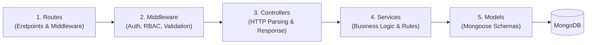
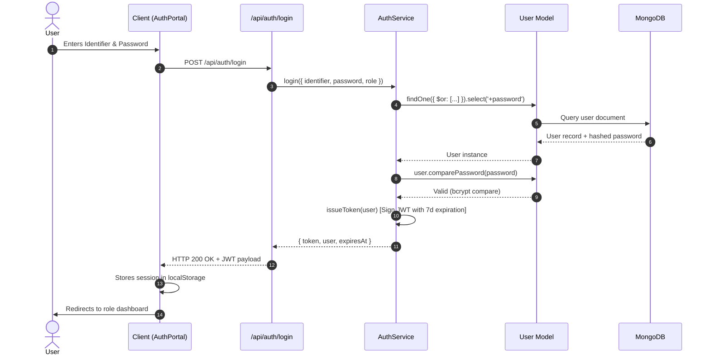

# WorkHive — System Architecture & Design

## 1. High-Level Architectural Overview

WorkHive is structured as an **enterprise multi-role platform** operating on a cooperative economic model. The system connects Customers, Workers, and Cooperative Administrators through a layered, decoupled full-stack architecture.

```mermaid
graph TD
    subgraph Client ["Frontend (React 18 + Vite)"]
        UI[User Interface / Shells]
        Router[Modular React Router v6]
        Guard[ProtectedRoute Session Guard]
        Context[Global State & Auth Context]
        APIClient[Axios Client with JWT Interceptors]
    end

    subgraph Server ["Backend (Node.js + Express)"]
        HTTP[HTTP Entry & Security Headers (Helmet)]
        RateLimit[Rate Limiters: General & Auth]
        Routes[API Routes: /api/*]
        Val[Input Validation Middleware]
        Auth[Auth & RBAC Middleware]
        Controllers[Transport Controllers]
        Services[Business Logic Services]
        Models[Mongoose ODM Models]
        Err[Centralized Error Handler]
    end

    subgraph Database ["Persistence Layer"]
        Mongo[(MongoDB 7 / Memory Server)]
    end

    UI --> Router
    Router --> Guard
    Guard --> UI
    UI --> Context
    Context --> APIClient
    APIClient -->|HTTP/JSON| HTTP
    HTTP --> RateLimit
    RateLimit --> Routes
    Routes --> Val
    Routes --> Auth
    Auth --> Controllers
    Val --> Controllers
    Controllers --> Services
    Services --> Models
    Models --> Mongo
    Controllers -.->|Catches / Throws| Err
    Services -.->|Throws ApiError| Err
    Err -->|Standardized JSON| APIClient
```

---

## 2. 3-Tier Backend Layering Pattern

The backend strictly separates responsibilities into discrete layers:



### Layer Responsibilities:

| Layer | Directory | Responsibility | Constraint |
|---|---|---|---|
| **Routes** | `server/routes/` | Defines HTTP verb and URI; mounts middleware; delegates to controller. | No business logic or database access. |
| **Middleware** | `server/middleware/` | Authentication, RBAC permission verification, payload validation, centralized error handling. | Calls `next()` on success or throws `ApiError`. |
| **Controllers** | `server/controllers/` | Extracts HTTP parameters (`params`, `query`, `body`, `user`), calls service methods, returns formatted JSON via `ApiResponse`. | Wrapped in `asyncHandler`; no direct Mongoose queries. |
| **Services** | `server/services/` | Executes business rules, cooperative surplus splits, OTP generation/verification, database transactions. | Pure business logic; no Express `req` or `res` objects. |
| **Models** | `server/models/` | Mongoose schema definitions, field validation, indexing, pre-save encryption hooks, helper methods. | Only defines database structure and schema hooks. |

---

## 3. Frontend Role-Based Modular Architecture

The frontend is structured by user roles to provide isolated workflows while reusing common UI tokens and services:

```text
client/src/
├── api/                     # Modular HTTP client functions grouped by domain
│   ├── apiClient.js         # Axios instance + JWT Bearer interceptor
│   ├── auth.api.js          # Authentication & Profile APIs
│   ├── customer.api.js      # Service discovery & Booking APIs
│   ├── worker.api.js        # Worker roster, Jobs & Claims APIs
│   ├── admin.api.js         # Telemetry & Admin APIs
│   └── index.js             # Consolidated exports
│
├── routes/                  # Modular Route Registry
│   ├── ProtectedRoute.jsx   # Enforces role session & 7-day TTL check
│   ├── PublicRoutes.jsx     # Style guide & public landing
│   ├── AuthRoutes.jsx       # Login, register, onboarding redirects
│   ├── CustomerRoutes.jsx   # /customer/* routes & aliases
│   ├── WorkerRoutes.jsx     # /worker/* routes & aliases
│   ├── AdminRoutes.jsx      # /admin/* routes & aliases
│   └── index.jsx            # Master router aggregator
│
├── apps/                    # Role-Specific Shells & Views
│   ├── admin/               # Admin dashboard, roster, complaints, services
│   ├── customer/            # Customer home, booking, tracking, checkout
│   └── worker/              # Worker dashboard, jobs, welfare, voting
│
├── components/              # Shared UI components (Button, Card, Badge, Sidebar, etc.)
├── context/                 # State management (AuthContext, LanguageContext, CustomerContext)
└── App.jsx                  # Clean application root mounting providers & AppRoutes
```

---

## 4. Authentication & Authorization Lifecycle



---

## 5. Security & Defense in Depth

1. **Password Hashing**: `bcryptjs` salted hashing on `User` schema pre-save hook; plain-text passwords are never persisted.
2. **JWT Session Protection**: Cryptographically signed 7-day tokens validated on protected routes; expired tokens return explicit 401 with `{ expired: true }`.
3. **Role-Based Access Control (RBAC)**: `authorizeRole('admin')` verifies role integrity server-side, preventing privilege escalation.
4. **OTP Security**: 6-digit cryptographically random OTPs hashed with SHA-256 before database storage; 5-minute TTL; strictly not disclosed in API responses.
5. **Rate Limiting**: `express-rate-limit` prevents brute-force login/registration attempts (max 30 requests/15 min) and API flooding (max 300 requests/15 min).
6. **HTTP Security Headers**: `helmet` configures `X-Content-Type-Options: nosniff`, `X-Frame-Options: SAMEORIGIN`, and other OWASP defenses.
