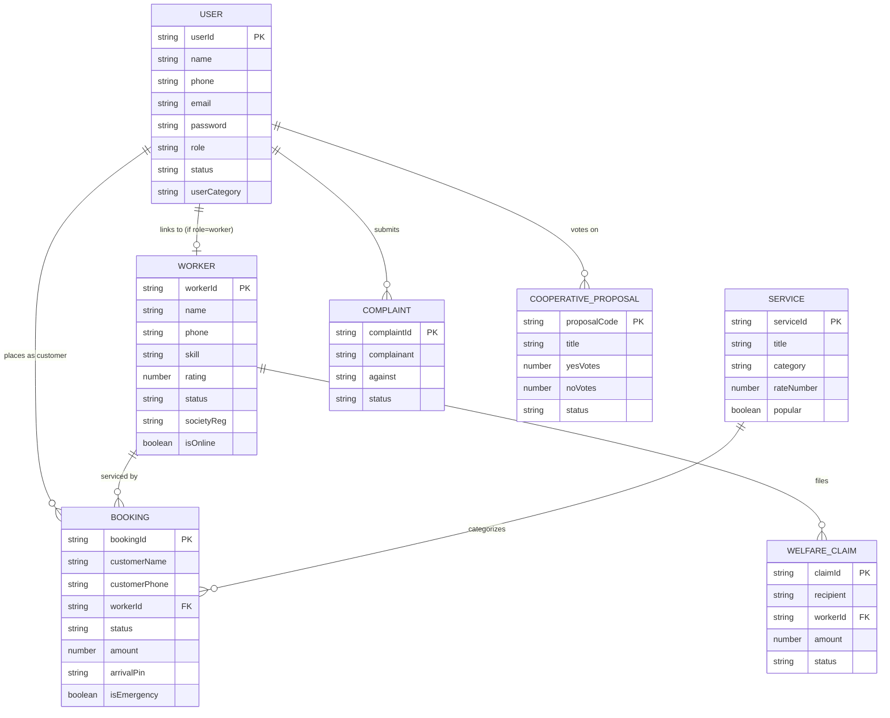

# WorkHive — Database Schema & Data Dictionary

The persistence layer is managed via **Mongoose ODM on MongoDB**.

---

## 1. Schema Entity Relationship Map

---

## 2. Collection Definitions

### `users` Collection
- `userId` (String, unique, indexed): Identifier format `cus-timestamp`, `wrk-timestamp`, `adm-timestamp`.
- `name` (String, required): Full name.
- `phone` (String, required, indexed): Primary contact number.
- `email` (String): Normalized lowercase email.
- `password` (String, select: false): Bcrypt hashed password.
- `role` (String, enum: `['customer', 'worker', 'admin']`): User access role.
- `status` (String, enum: `['Active', 'Verified', 'Pending', 'Suspended']`).
- `userCategory` (String, enum: `['household', 'institution', 'worker', 'officer']`).

### `workers` Collection
- `workerId` (String, unique, indexed): Maps to `userId`.
- `skill` (String, required): Primary trade (e.g., Plumbing, Electrician).
- `skills` (Array of Strings): Additional qualifications.
- `rating` (Number, 0-5): Aggregated customer rating.
- `completedJobs` (Number): Counter of completed service orders.
- `status` (String, enum: `['Verified', 'Pending', 'Suspended']`).
- `isOnline` (Boolean): Real-time availability toggle.
- `societyReg` (String): Cooperative registry reference.

### `bookings` Collection
- `bookingId` (String, unique, indexed): ID format `BK-XXXX`.
- `customerName` & `customerPhone` (Strings): Customer details.
- `workerId` & `workerName` (Strings): Assigned service provider.
- `serviceCategory` (String): Target service trade.
- `amount` (Number): Gross transaction value in INR.
- `status` (String, enum: `['pending', 'accepted', 'on_the_way', 'arrived', 'working', 'in_progress', 'completed', 'paid', 'rated', 'cancelled']`).
- `isEmergency` (Boolean): Priority dispatch flag.
- `isLocationSharing` (Boolean): Live GPS telemetry flag.
- `arrivalPin` (String): 4-digit security authentication PIN.

### `services` Collection
- `serviceId` (String, unique, indexed): Slug identifier.
- `title` (String): Display name.
- `category` (String): Service department.
- `baseRate` (String) & `rateNumber` (Number): Visit fee / service rate.
- `popular` (Boolean): Featured catalog item.

### `complaints` Collection
- `complaintId` (String, unique): ID format `GRV-YYYY-XX`.
- `complainant` (String): Filing party.
- `against` (String): Target party.
- `status` (String, enum: `['Open', 'In Review', 'Resolved']`).

### `cooperativeproposals` Collection
- `proposalCode` (String, unique): ID format `PROP-YYYY-XX`.
- `title` & `description` (Strings): Resolution details.
- `yesVotes` & `noVotes` (Numbers): Member voting counters.
- `status` (String, enum: `['active', 'closed', 'passed']`).

### `welfareclaims` Collection
- `claimId` (String, unique): ID format `CLM-XXXX`.
- `workerId` (String): Member claimant.
- `amount` (Number): Claim payout in INR.
- `category` (String): Subsidized equipment or medical grant.
- `status` (String, default: `Settled`).

### `otps` Collection
- `phone` (String, indexed): Recipient phone number.
- `otpHash` (String): SHA-256 hash of 6-digit passcode.
- `attempts` (Number, default: 0): Rate limiting counter (max 5).
- `expiresAt` (Date): TTL expiration (5 minutes).
